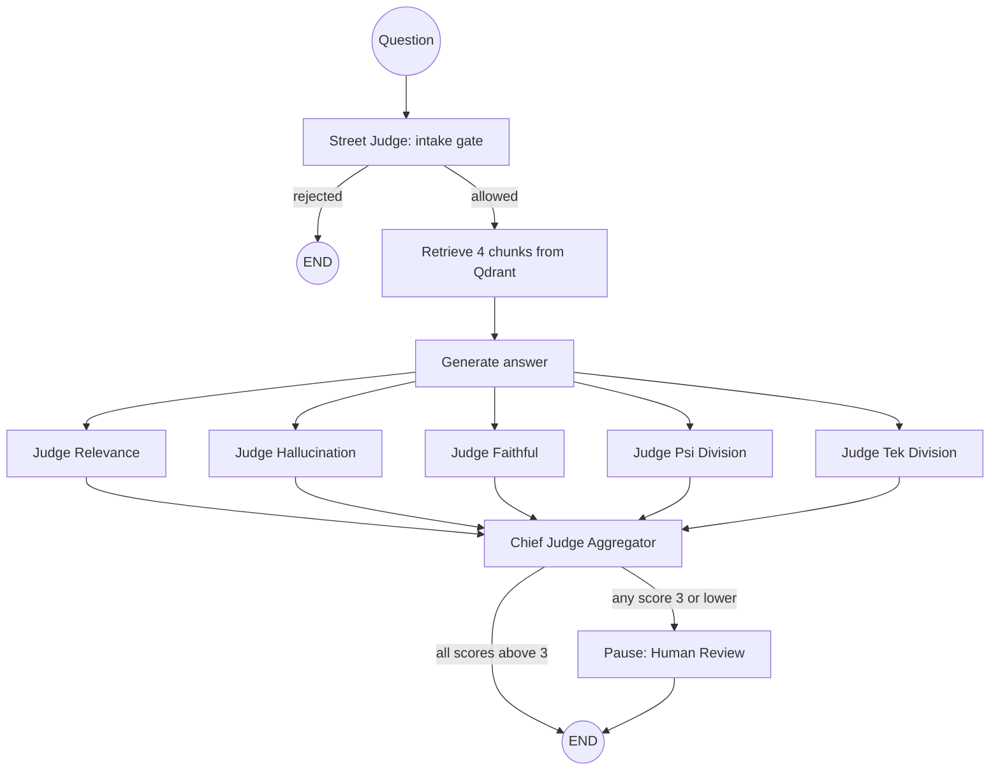

<p align="center">
    
</p>

# ⚖️ JudgeThreadd: Agentic Evaluation Pipeline

**A learning project: LLM-as-a-judge evaluation of a RAG agent.**

The idea behind it: a RAG system can fail silently, for example by answering with something its documents do not say. This project explores how LLM judges can catch such answers.

JudgeThreadd is a demo evaluation harness. A small RAG agent answers questions from a PDF indexed in Qdrant, and a "Council of Judges" (five LLM judges running in parallel) scores each answer from 1 to 5 for relevance, hallucination, faithfulness, intent alignment and technical accuracy. Low scores pause the run at a human-review checkpoint.

It is a learning project, not a production tool. See [Status and known limits](#-status-and-known-limits).

## ⚡ Quick Start

Install the [Taskfile CLI](https://taskfile.dev/installation/) first:

```bash
npm install -g @go-task/cli
```

Then:

```bash
# create a .env file first (see "Environment Variables" below)
task install              # install Python + frontend dependencies
task init-db              # one-time setup: creates Qdrant collection + Supabase tables
task run                  # Windows: opens backend (localhost:8000) + frontend (localhost:5173) in separate windows
```

### All Commands

| Command | What it does |
|---|---|
| `task install` | Install Python + frontend dependencies |
| `task run` | Start backend and frontend in separate windows (Windows only) |
| `task backend` | Start just the FastAPI server (`localhost:8000`) |
| `task frontend` | Start just the Vue UI (`localhost:5173`) |
| `task init-db` | One-time setup — creates Qdrant collection and Supabase tables |
| `task generate-dataset` | Generate 20 test cases from the PDF using Gemini |
| `task evaluate` | Run batch evaluation over the Ground Truth Cases |
| `task report` | Print analytics dashboard from the latest report |
| `task test-rag` | Smoke-test the RAG pipeline with 3 sample questions |

---

## 🛠️ The Tech Stack

* **Orchestration:** LangGraph (Parallel DAG execution)
* **Backend:** FastAPI (Python, Server-Sent Events/SSE)
* **Frontend:** Vue.js 3 (Tailwind CSS, Vite, Real-time telemetry)
* **Episodic Memory:** Supabase (PostgreSQL with `PostgresSaver`); optional, falls back to in-memory state
* **Semantic Search:** Qdrant Cloud (Vector Database), embeddings from `sentence-transformers/all-MiniLM-L6-v2`
* **LLMs:** Groq `llama-3.3-70b-versatile` by default, or a local Ollama model. The agent and the judges use the same model. Gemini generates the test dataset.

## 🧠 System Architecture

There are two LangGraph graphs.

**1. The agent under test** (`app/agent/baseline_rag.py`). An intake gate (the "Street Judge") rejects off-topic, vague or unclear questions; only questions about Python and the indexed book pass. Allowed questions go to retrieval (the 4 most similar chunks from Qdrant) and then to answer generation.

**2. The evaluation graph** (`app/agent/evaluation_graph.py`). It takes the question, the context and the agent's answer, and fans out to five judges in parallel. Each judge returns a structured result (`name`, `score`, `rationale`). An aggregator averages the scores and, if a database is configured, logs the result. If any score is 3 or lower, the graph pauses before a human-review step.



If a database is configured, each run is stored with the status `APPROVED` (average of 3.5 or higher) or `DRIFT DETECTED`.

## 🏗️ First-Time Setup: Building the Vector Database

Before running any evaluations, you must ingest the baseline data into your Qdrant vector database. If you skip this, the agent will throw a `404 Not Found` error.

The setup script reads `public/test-content/thinkpython.pdf` ("Think Python"). The PDF is not part of this repository: place your own copy at that path before running `task init-db`. Afterwards you can replace the document through the UI.

Run the one-time setup command to create the `portfolio_docs` collection and Supabase tables:

```bash
task init-db
```

### Step 1: Define Your Dataset

To test an agent, you need a baseline of questions.

* Open `data/golden_dataset.json` and observe the format of Ground Truth Cases (Python questions with reference contexts).
* Replace the contents with a JSON array of your own historical user queries and the expected ground-truth contexts.

### Step 2: Modify the "Brain" 

This pipeline evaluates whatever logic exists inside `app/agent/baseline_rag.py`.

To test a change:

* **Testing a new model:** Set `GROQ_MODEL` in `.env` (default `llama-3.3-70b-versatile`), or set `LLM_PROVIDER=ollama` and `LOCAL_MODEL` to use a local model.
* **Testing a new prompt:** Update `_GENERATE_ANSWER_PROMPT` in `baseline_rag.py` with new instructions to see if the AI adheres to them better.
* **Testing retrieval:** Change the retriever's `search_kwargs={"k": 4}` to retrieve more or fewer chunks, or change `chunk_size` and `chunk_overlap` in `init_db.py` and re-run `task init-db`.

### Step 3: Run the Batch Evaluator

Do not type questions one by one into the UI. Instead, run the batch evaluation over the test cases:

```bash
task evaluate
```

## 🖥️ The Grand Hall Telemetry Dashboard (UI)

While the batch runner is for automated testing, the **Grand Hall Dashboard** is a reactive Vue.js interface built for visual debugging of single queries.

### How to Launch the UI

Run both servers at once with:

```bash
task run
```

Or start them individually in separate terminals:

```bash
task backend    # FastAPI server → localhost:8000
task frontend   # Vue UI → localhost:5173
```

Then open your browser to <http://localhost:5173>.

## 🔑 Environment Variables

Create a `.env` file in the root directory. You need accounts with Groq and Qdrant (Cloud or local).

```env
GROQ_API_KEY="gsk_your_groq_api_key"
QDRANT_URL="https://your-cluster-url.qdrant.tech"   # or http://localhost:6333 for local
QDRANT_API_KEY="your_qdrant_api_key"                # required by the code, also for a local Qdrant

# Optional
SUPABASE_DB_URI="postgresql://..."   # stores evaluation history and graph state; without it nothing is persisted
GOOGLE_API_KEY="..."                 # only for `task generate-dataset` (Gemini)
LLM_PROVIDER="groq"                  # or "ollama"
GROQ_MODEL="llama-3.3-70b-versatile"
LOCAL_MODEL="qwen2.5:3b"             # used when LLM_PROVIDER=ollama
```

`task init-db` needs `SUPABASE_DB_URI`, because it also creates the Postgres tables.

## 🚧 Status and known limits

This is a learning project built on one sample document.

* **The judges are not calibrated.** Their scores have not been compared with human-labelled answers, and the judges use the same model as the agent they judge.
* **It judges its own built-in agent.** The evaluation graph takes a question, a context and an answer, but there is no API endpoint yet for submitting answers from another agent.
* **Human review is only a pause.** The graph stops before the human-review step and keeps its state (in memory only, unless Postgres is configured). There is no endpoint or screen yet for a person to approve and resume.
* **Retrieval quality is not measured.** The dataset run in the UI gives the judges the dataset's reference context; `task evaluate` gives them the retrieved chunks. Neither compares the two, and the dataset's `expected_answer` is not used yet.
* **No automated tests.**
